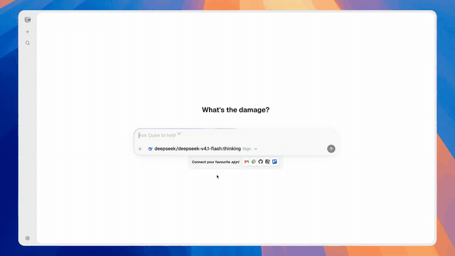

# Qube

<p align="center">
  
</p>

<p align="center">
  <strong>An AI agent for anyone.</strong>
</p>

<p align="center">
  A free, open-source, local-first desktop assistant that does the work instead of just suggesting it — no terminal, no server to manage, no Qube subscription.
</p>

---

## What is Qube?

Qube is a personal assistant that lives on your computer. You tell it what you
want in plain language and it gets the job done: researching online, writing
documents and spreadsheets, organizing files, driving a browser, and working
inside the apps you already use.

It is an autonomous agent, not a chatbot: it plans the steps, uses tools,
checks its own work, and keeps going until the task is finished. Before
sensitive actions it double-checks them against your request and asks for
your approval when in doubt; destructive actions such as deleting files are
off unless you turn them on. Qube itself runs on your machine, and your
files, chats and settings stay there — what you ask is sent to the AI
provider you choose.

You bring the AI. Qube doesn't ship with a model — sign in with a ChatGPT
subscription, paste an API key for one of 40+ built-in provider presets
(OpenAI, Anthropic, Google, OpenRouter and many more) or any OpenAI-compatible
endpoint, or point it at a local model through Ollama or LM Studio. You only
ever pay your AI provider.

## What you can do with it

- **Finish real work, not just talk about it.** Ask for a tailored CV and
  cover letter, an insurance comparison with the math shown, or a folder of
  invoices totaled into a spreadsheet — and get actual files back.
- **Get real Office documents.** Properly formatted `.docx`, `.pptx` and
  `.xlsx` files (with live spreadsheet formulas), plus Markdown, CSV, PDFs
  and images, all organized in a tidy local workspace and shown as file cards.
- **Research without a dozen tabs.** Qube searches, reads pages, and returns
  short sourced answers with citations — and opens a watchable browser for
  forms, bookings and tracking, handing you control for logins and two-factor
  prompts.
- **Work inside your apps.** Connect Gmail, Google Calendar and Drive, Slack,
  GitHub, Notion, Linear, Jira, Trello, Asana, Airtable, HubSpot, Dropbox and
  Canva with a normal sign-in window. Sends and creates are double-checked
  and wait for your approval when in doubt; read-only lookups don't.
- **Let it remember and repeat.** It remembers your preferences and projects
  across chats, learns reusable playbooks, and can run scheduled tasks and a
  periodic check-in while the app is open.
- **Control your whole computer when you ask.** An optional driver lets it
  click and type in other desktop applications, with every mutating action
  reviewed and confirmed with you when in doubt.

## Quickstart

1. **Download** the installer for your platform from the
   [Releases page](https://github.com/QwErTy-2117/Qube/releases) — Windows
   (`.exe`/`.msi`), macOS (`.dmg`/`.zip`), or Linux (`.deb`/`.rpm`) — and
   install it like any desktop app. No Node.js or terminal needed.
2. **Open Qube** and follow onboarding: accept the terms, connect your AI
   (ChatGPT sign-in or a provider key), and optionally connect apps.
3. **Say what you want.** For example:

   > *“Research good first bikes for a 6-year-old under €150 and give me a short sourced comparison with three options.”*

   Qube searches and reads pages on its own, shows its progress, and comes
   back with a cited answer — no setup beyond choosing an AI. Once you connect
   apps in Settings, you can also ask it to triage Gmail, post to Slack, file
   GitHub issues and more.

**A couple of prerequisites worth knowing:** browser automation needs a
Chromium-based browser installed (Chrome/Chromium, or Edge on Windows);
generating real Office files works best with Python 3 + pip on the machine.
Full details in [Getting started](docs/getting-started.md).

## Documentation

Read the documentation website at
**[qwerty-2117.github.io/Qube](https://qwerty-2117.github.io/Qube/)**, or
browse the same pages directly in [`docs/`](docs/README.md) on GitHub.

**Start here**

- [Getting started](docs/getting-started.md) — install, onboarding, first task
- [Choose your AI](docs/ai-providers.md) — ChatGPT sign-in, API keys, local models
- [Having conversations](docs/conversations.md) — goals, questions, attachments, history

**Guides**

- [Files and the workspace](docs/files-workspace.md) · [Web research](docs/web-research.md) · [Browser automation](docs/browser.md) · [Computer use](docs/computer-use.md)
- [Connected apps](docs/connectors.md) · [Memory and skills](docs/memory-and-skills.md) · [Automations](docs/automations.md)
- [Permissions and privacy](docs/permissions-privacy.md) · [Desktop app details](docs/desktop.md) · [Troubleshooting](docs/troubleshooting.md)

**Power users and contributors**

- [Custom MCP servers](docs/mcp.md) · [Qube as an ACP agent](docs/acp.md) · [Environment variables](docs/configuration.md) · [Development and architecture](docs/development.md)
- [Architecture](docs/architecture.md) · [Documentation website](docs/docs-site.md) · [Maintainability audit](docs/maintainability-audit.md)
- [Terms of Service](TERMS.md) · [Privacy Policy](PRIVACY.md)

## Run from source

You don't need this to use Qube — it's for developers and contributors.

```bash
git clone https://github.com/QwErTy-2117/Qube.git
cd Qube
npm install
cp .env.example .env.local   # optional; most settings are configured in-app
npm run dev                  # http://localhost:3010
```

Building the desktop app additionally needs Rust and the
[Tauri prerequisites](https://tauri.app/start/prerequisites):

```bash
node scripts/build-sidecar.js
npm run tauri:build
```

See [Development and architecture](docs/development.md) for the full setup,
test suite, and codebase map.

## Safety and responsibility

Qube acts on your instructions and your approvals, which means you are
responsible for what it does on your behalf — including actions in connected
apps that you didn't foresee step by step. It can make mistakes like any AI,
so review important work and keep backups. Reads and in-workspace work happen
freely; sends, outside-workspace access and computer control are checked
against your request and confirmed with you when in doubt; deletes and other
destructive actions are blocked unless you enable them. Actions inside the
built-in browser and tools from MCP servers you add are not approval-gated, so
be specific. Your data stays local and is sent to your chosen AI provider
(and, for connected apps, through Composio) to fulfill your requests. See
[Permissions and privacy](docs/permissions-privacy.md), the
[Terms](TERMS.md) and [Privacy Policy](PRIVACY.md).

## License

Apache 2.0 — see [LICENSE](LICENSE).

## Support Qube

Qube is free and open-source. If it saves you time, you can support its
development:

- **BTC:** `bc1qkn3slg3ql0z7xfuzqzwkcx3jv6my7t6xq6ekek`
- **SOL:** `EF8MNkBgeifY3KUtPHzQvQg4o2qw3MCQE1WkVrvFsEjM`
- **ETH:** `0x57C7de26041eab3cafbF7e024E1CC0817E2daf6F`
