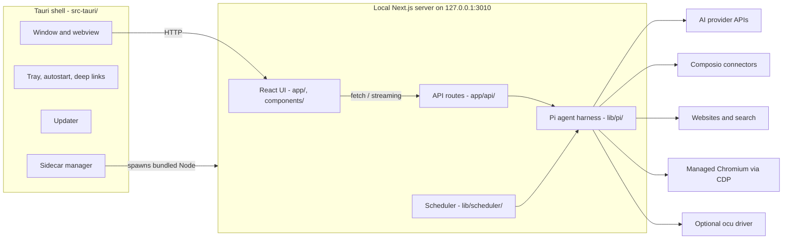
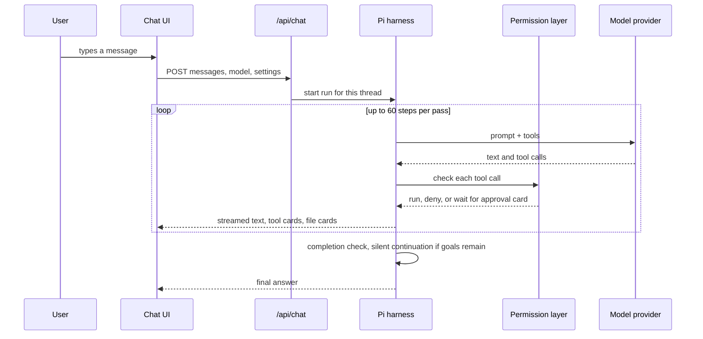
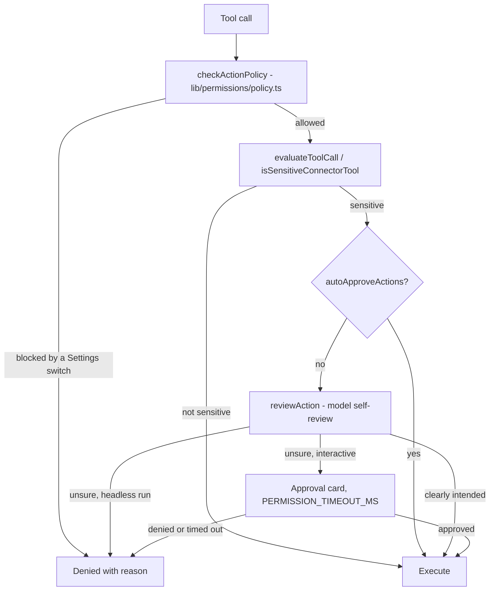
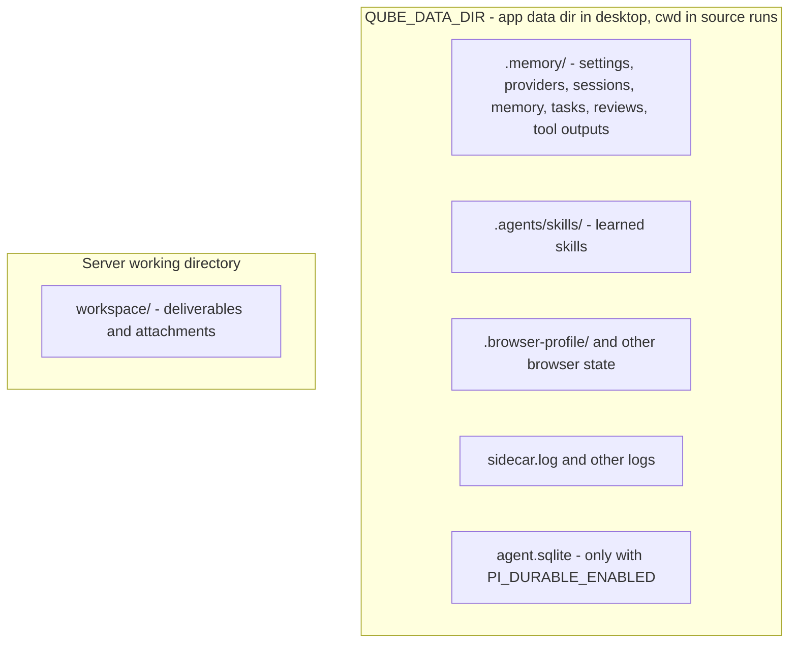
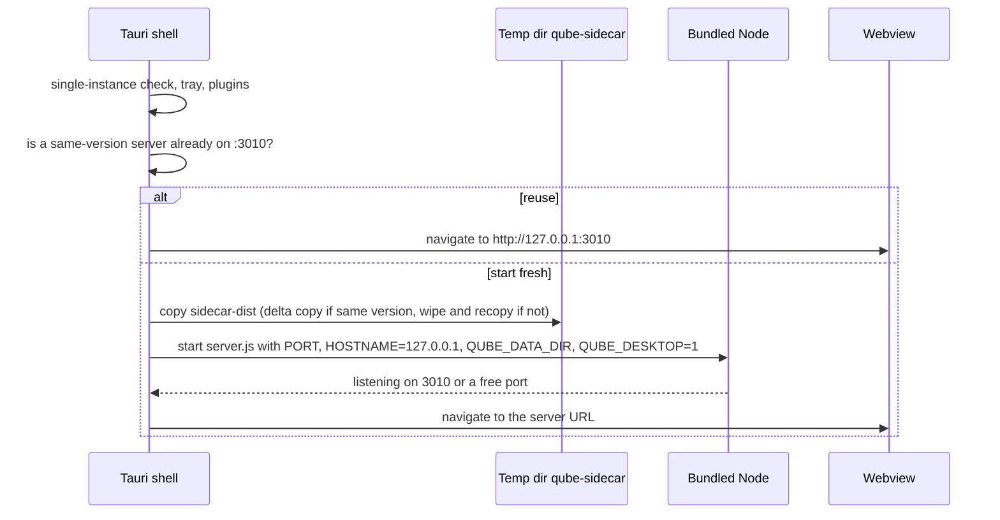

# Architecture

This page explains how Qube is put together, for contributors who want to
change the code. It describes the repository as of version `0.0.118`. For
setup, tests and contribution rules, see
[Development and architecture](./development.md).

## The big picture

Qube is a single **Next.js 16 (App Router)** application that serves both the
React interface and a set of API routes. In the desktop app, a thin **Tauri 2**
shell written in Rust starts that Next.js server as a local child process —
the **sidecar** — and shows it in a native webview. Everything runs on the
user's machine; the only outside services are the ones the user chooses (an
AI provider, Composio for connected apps, websites the agent reads).

When running from source (`npm run dev`), the same Next.js app runs on
`http://localhost:3010` without the Tauri shell.

## Repository layout

| Path | What lives there |
| --- | --- |
| `app/` | Next.js App Router. `page.tsx` (home), `chat/[id]` (a conversation), `connectors/callback` (OAuth return screen), and 55 API route handlers under `app/api/` grouped by area: `chat`, `settings`, `providers`, `chatgpt`, `connectors`, `scheduler`, `browser`, `files`, `external-files`, `workspace`, `memory`, `skills`, `mcp`, `permission(s)`, `ask-user`, `threads`, `usage`, `legal`, `reset`, `setup`, `proactivity`, `observability`, `durable`. `app/pptx-test` is a development test page. |
| `components/` | React UI. `components/examples/base.tsx` is the main chat surface; `components/assistant-ui/` holds the thread, composer, model picker and tool-activity cards; `components/shared/` holds dialogs such as Settings and onboarding. |
| `lib/pi/` | The agent harness: model clients, system prompt, tool registry, subagents, MCP loading, compaction, execution limits, background task runner. |
| `lib/agent/` | Shared agent helpers: completion verifier, execution ledger, checkpoints, session usage, capability detection, SSRF guard. |
| `lib/permissions/`, `lib/middleware/` | Permission policy and classification, the approval/self-review middleware, workspace resolution, allowed directories. |
| `lib/scheduler/` | Tick loop, task store, heartbeat, discovery sweep, announcements, AI task drafts. |
| `lib/memory/`, `lib/skills/`, `lib/learning/`, `lib/proactivity/` | Long-term memory, skills and marketplace, skill learning, proactive suggestions. |
| `lib/connectors/` | Composio client, curated toolkit map, logos, key storage. |
| `lib/browser/`, `lib/computer-use/` | Managed Chromium (launch, CDP screencast, built-in browser MCP service) and the OS-level computer-use pipeline. |
| `lib/chat/`, `lib/workspace/`, `lib/artifact/` | Thread storage and attachments; spreadsheet/presentation helpers for the viewers; artifact sanitizing. |
| `lib/chatgpt/` | ChatGPT sign-in support (Codex client version lookup). |
| `lib/acp/` | Agent Client Protocol adapter (`npm run acp`). |
| `lib/system/` | Hard Reset (server and client side). |
| `lib/codex/` | Deprecated forwarding shim; do not add callers. |
| `instrumentation.ts` | Starts the scheduler when the Node server boots. |
| `src-tauri/` | Rust desktop shell: sidecar lifecycle, tray, updater, autostart, Hard Reset finalization. |
| `scripts/` | Sidecar build, test runner, legal sync, PDF worker sync, updater manifest, MCP smoke test, durable migration. |
| `tests/` | 112 `node:test` suites run with `tsx` (`npm test`). |
| `public/` | Static assets, including `legal/` copies of the Terms and Privacy Policy produced by `scripts/sync-legal.js`. |
| `docs/`, `docs-site/` | This documentation and the website generated from it. |

## How a chat message is handled

Key points, with the code that implements them:

- **One harness.** `lib/pi/harness.ts` is the production agent loop, built on
  the AI SDK's `streamText`. A separate SQLite-backed durable harness exists
  behind `PI_DURABLE_ENABLED=1` but is an unfinished migration.
- **Limits** live in `lib/pi/execution-limits.ts`: 60 steps per pass
  (`PI_HARNESS_MAX_STEPS`), two verification rounds, 32 concurrent runs, a
  five-minute rolling run timeout (extended by productive goal rounds up to
  `PI_HARNESS_MAX_TOTAL_MS`), eight silent nudge rounds
  (`QUBE_SILENT_CONTINUATIONS`), and up to 30 goal-continuation rounds
  (`QUBE_GOAL_CONTINUATIONS`) while TodoWrite items are open. Goal rounds stop
  early after three no-progress rounds or two consecutive error rounds.
- **Steering.** A new message on the same thread aborts the previous run and
  starts a new one. Runs on different threads proceed in parallel.
- **Context management.** `lib/pi/compaction.ts` summarizes older history
  when the context window fills, and `lib/pi/tool-output.ts` spills large tool
  results to `.memory/tool-outputs/` for paged reads.
- **Completion gate.** `lib/agent/completion-verifier.ts` checks open todos,
  tool errors and claimed files before a run is reported as done.
- **Project instructions.** `lib/pi/project-instructions.ts` loads
  `AGENTS.md`, `QUBE.md`, `CLAUDE.md` and `.qube/` rules from the workspace
  (16 KB per file, 32 KB total).

## The permission layer

Every built-in tool, connector tool and computer-use tool is wrapped by
`withPermissionCheck` in `lib/middleware/permission-middleware.ts`:

- The hard policy reads `allowTools`, `allowConnectors` (default on),
  `allowDestructiveActions` and `autoApproveActions` (default off) from app
  settings. Destructive kinds are file deletion, destructive shell commands,
  protected paths, external deletes, merging pull requests and closing issues.
- Self-review verdicts are appended to `.memory/action-reviews.jsonl`.
- Background runs use `createTaskPermissionChecker`, which applies the same
  policy plus per-task permission flags; the heartbeat's sensitive connector
  tools are replaced with draft-only stubs.
- **Not wrapped:** tools from user-added MCP servers (merged directly in
  `lib/pi/harness.ts`) and in-page actions of the built-in browser service.
  See the [maintainability audit](./maintainability-audit.md).

## Background work

`instrumentation.ts` calls `ensureSchedulerStarted()` when the Node server
boots. The scheduler ticks every 60 seconds, runs due scheduled tasks through
`lib/pi/task-runner.ts`, and runs the heartbeat (every 30 minutes by default)
whose deterministic sweep in `lib/scheduler/discovery.ts` decides whether a
model call is needed at all. Missed runs are caught up once on start.
Background runs are limited to 12 (heartbeat) or 20 (scheduled) steps per
round, three rounds and a three-minute timeout, and fall back from a ChatGPT
sign-in model to the first enabled API-key model. Results are delivered as
announcements in the next chat (`lib/scheduler/announcements.ts`).

## Where state lives

- `lib/data-dir.ts` resolves `QUBE_DATA_DIR` (default: the working directory).
- `lib/middleware/workspace.ts` resolves the workspace: `WORKSPACE_PATH`, else
  `<cwd>/workspace` (`WORKSPACE_DIR_NAME`), else a legacy `<cwd>/playground`.
- All state is plain JSON or JSONL on disk; provider keys in
  `.memory/providers.json` are not encrypted.

## The desktop shell

- `src-tauri/src/sidecar.rs` prepares the temporary copy and starts the
  server. Because the server's working directory is that temporary copy, the
  workspace lives there too and is removed on version changes.
- `src-tauri/src/lib.rs` handles window close: with `keepAlive` off the app
  exits; with it on, the window is hidden and the server keeps running.
- `src-tauri/src/commands.rs` exposes `get_port`, `set_autostart` and
  `finalize_hard_reset` (deletes app data, cache, config, local-data and log
  directories plus the sidecar copy, then restarts the sidecar).
- The updater plugin reads
  `https://github.com/QwErTy-2117/Qube/releases/latest/download/latest.json`,
  produced in CI by `scripts/build-updater-json.mjs`.
- The webview CSP is disabled (`"csp": null` in `tauri.conf.json`).

## Legal documents in the app

`TERMS.md` and `PRIVACY.md` at the repository root are the source of truth.
`scripts/sync-legal.js` copies them into `public/legal/`, and
`app/api/legal/*` serves them to onboarding and Settings. Keep them at the
root.

## Build and release

`.github/workflows/build.yml` type-checks, runs the tests and `cargo test`,
builds the sidecar with `scripts/build-sidecar.js` (Next.js standalone output
plus a bundled Node runtime), smoke-tests it with `scripts/smoke-mcp.js`, and
packages installers for Windows, macOS and Linux. The documentation website
has its own workflow, `.github/workflows/docs.yml` — see
[Documentation website](./docs-site.md).
