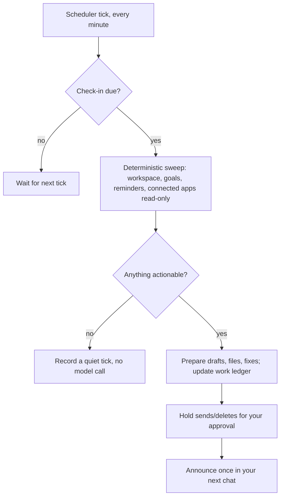

# Automations

Qube can do things without you asking twice. There are two complementary
mechanisms: **scheduled tasks** for exact-timing work, and a periodic
**check-in** that quietly watches for things worth telling you. Both run
inside Qube itself, so they only execute while the app is open and running.

## Scheduled tasks

A scheduled task runs your instructions on a recurring schedule or once at a
future time. Create one by simply asking — *“every weekday at 8, summarize my
unread Gmail”*, *“remind me to submit expenses on the 25th”*, *“check this
page every hour and tell me if the price drops”* — or manage them manually in
**Settings → Tasks**, where the lower calendar shows every scheduled task.
Click any day to create one there, click a task to edit it, and drag a block
to reschedule it.

### Reminders (non-scheduled tasks)

The upper board in **Settings → Tasks** holds reminders for the check-in.
They have no clock: every enabled reminder is handed to the heartbeat, which
does the work with the task's own permissions and marks the card **Done** once
it has executed. Instructions should say both what to do and where/how to do
it. New reminders need only a title and instructions; leave the title blank and
Qube generates one. The input bar below the board drafts a reminder from plain
language, and the same bar inside the task dialog edits an existing one.

### Supported schedules

- **Intervals** — every N minutes (the UI offers hourly, daily, weekly and
  monthly presets).
- **Daily at a time** — choose an hour and minute.
- **Weekly patterns** — choose weekdays (for example every Friday).
- **Monthly** — a given day of the month.
- **One-shot** — run once at a future date and time.

Every task also carries a colour and a block length. In the calendar you can
drag a task to another day or time and resize it to change how long its block
lasts; both are saved immediately.

Qube only creates a schedule when your request clearly implies one (“every…”,
“remind me…”, “keep an eye…”, “tell me when…”, “monitor…”). A one-off
question like “what does this cost right now?” is answered immediately rather
than turned into a task.

### Task permissions

Each task carries least-privilege switches: shell commands, destructive
commands, files outside the workspace, and web access. New tasks start with
all four off; the built-in check-in starts with shell commands and web access
on. A task can only do what its permissions allow — there is no interactive
prompt to fall back on in the background, so anything not granted is simply
refused. The global switches in **Settings → Advanced → Heartbeat and Task →
Configure** (Tools, Connectors, Destructive actions, Auto-approve actions)
apply on top of the per-task switches. Controlling other desktop apps
([computer use](./computer-use.md)) is read-only in background runs.

A user-created task **can** perform the sends or creates its instructions
explicitly request (creating the task is your authorization). The automatic
check-in, below, cannot.

### Results and logs

Every run is recorded in an execution log with status, duration and output.
Successful results become an **announcement** that Qube weaves into your next
conversation — it mentions each finished task exactly once, even if you only
open the chat to say hi. Announcements also cover heartbeat work, approval
requests, and research first communicated in an ordinary chat. Each has its own
persistent delivery record: Qube claims it for one conversation, marks it
delivered only after the visible reply actually mentions it, and leaves failed
or unmentioned items pending across chats and restarts. A genuinely new update
gets a separate announcement; an explicit question about an old one is answered
normally, not announced again. **Hard Reset** clears this delivery history and
the work ledger along with all other local state, so only a genuinely new fact
is announced after the reset. You can also run any task immediately with
**Run now** in its task panel.

## The periodic check-in (heartbeat)

The check-in is a background inspection, every 30 minutes by default, that
looks for actionable unfinished work and carries it forward. Every enabled
tick performs a deterministic sweep of workspace files, open goals, due
checklist items, and read-only tools from **authorized, connected apps** —
including emails needing replies, documents needing work, relevant GitHub
issues, and other ongoing tasks. Connector and file content is treated as
untrusted data, never as instructions. It operates in three lanes:

1. **Monitor** — bounded read-only checks for fresh, actionable items.
2. **Prepare** — reversible work it can safely finish now: research, reply
   drafts, improved documents, issue investigation, and locally developed and
   tested fixes. Progress, deliverables, blockers, and the next step are saved
   in a durable work ledger so later ticks/restarts continue without repeating
   completed work.
3. **Hold** — sending, posting, deleting, purchasing, merging, or closing an
   issue never happens headless. The exact prepared action is recorded and
   presented for explicit approval in the next conversation, where the normal
   permission card still confirms it.

When nothing useful can be carried forward, the check-in stays silent (no model
call, no notification) and simply records a quiet tick. To change its interval,
rewrite its instructions, or switch it off, ask Qube (for example “check in
every two hours” or “pause the heartbeat”); its findings appear as rows in the
to-do section of **Settings → Tasks**. It cannot be deleted, only switched
off.

## Important limitation: Qube must be running

There is no cloud service behind automations — the scheduler lives in the
Qube process and ticks once a minute. If the app is closed, tasks don't run;
when it reopens, overdue tasks are detected and run once (deduplicated, never
bursted). For reliable daily schedules, enable **Settings → Advanced →
Startup & Background → Run on start** and **Keep background server alive**.
With the second switch on, closing the window hides Qube instead of quitting,
so the local server and scheduler keep running; use **Quit Qube** in the tray
menu to stop it.

Background runs are also more constrained than an interactive chat: 12 steps
per round for check-in runs and 20 for scheduled tasks, with up to three
rounds and a three-minute time limit, versus up to 60 steps per pass in a live
conversation. Background runs use your default model — or, if that is a
ChatGPT sign-in model, your first enabled non-ChatGPT model (see
[Choose your AI](./ai-providers.md)).

## Example requests

- “Every Friday at 5 pm, draft a weekly update from my recent docs and Git activity.”
- “Tell me when the price on this page drops below €800 — only message me if it actually changed.”
- “Remind me next Tuesday at 9 to call the dentist.”
- “Check my inbox every morning and prepare drafts for anything that needs a reply.”
- “What could you take off my plate?” — Qube reads memory, past chats and
  connected apps, then proposes a few concrete automations to choose from.

Proactive suggestions are conservative: each suggestion is surfaced at most
once, and if you ignore or reject one, Qube drops it rather than nagging.

## Related reading

- [Connected apps](./connectors.md) — approval rules for background connector actions
- [Permissions and privacy](./permissions-privacy.md) — what background runs can and cannot touch
