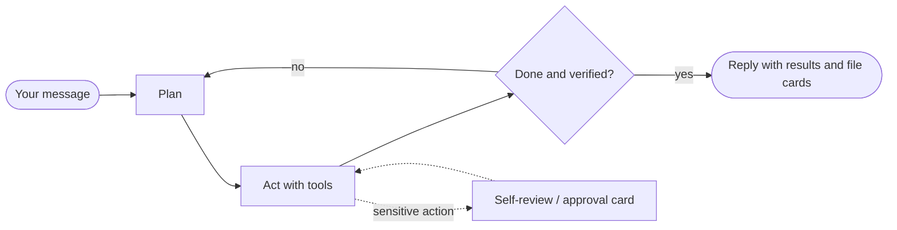

# Having conversations

Qube is an autonomous agent, not a chatbot that only suggests next steps. You
describe the outcome; Qube plans, acts, verifies, and keeps going until the
job is done. This page explains what you see during a conversation and how to
steer it.

## How a task runs

When you send a message, Qube works in a loop: plan → act → verify → repeat,
up to 60 tool steps in a single pass. If the job is not finished when a pass
ends — for example goals on the checklist are still open — it silently
continues with another pass (up to eight continuation rounds), and it can run
up to two extra verification passes to check its own work, rather than handing
you a half-done result. A single message can run for up to five minutes.

During the run you will see:

- **Plain-language activity cards** — “searching the web”, “writing a
  document”, “checking your calendar” — never raw tool names.
- **The goals panel** — a floating checklist for multi-step work. Each item
  moves through pending, in progress, and completed so you always know where
  the job stands.
- **Approval cards** — for sensitive actions the invisible self-review is
  not sure about. See [Permissions and privacy](./permissions-privacy.md).
- **File cards** — finished documents, spreadsheets, presentations and images
  appear as cards at the end of the reply. Open them in the built-in viewer
  or download them.
- **Visual answers** — when numbers need comparing or options belong side by
  side, Qube can render a native card with charts, tables, key facts, badges
  and follow-up buttons instead of plain text. These use assistant-ui's
  built-in generative UI with a fixed, allowlisted component set, so no HTML
  or scripts from the model ever run.

## Asking questions back

Qube only stops to ask when it is genuinely blocked: a real choice, ambiguous
scope, or confirmation for something hard to undo. Questions appear in a
panel above the composer, sometimes as multiple-choice options and always
with a free-text alternative. Several questions for one decision are batched
into a single panel, so you won't be interrogated one question at a time.

If you don't answer within five minutes, Qube proceeds with its best
judgment, states its assumptions in one sentence, and continues.

## Steering and stopping

- **Change direction mid-run:** just send another message. Qube quietly
  stops the current run and starts again with your new instruction — the
  conversation stays one continuous thread. Switching to another chat does
  not stop a run; several chats can work at the same time.
- **Stop a run:** use the stop button in the composer. The partial work
  (files written, notes taken) remains in place.
- **Edit a message:** you can edit a previous message and re-run from there.

## Attachments and voice

- **Attach files** with the paperclip button or by dragging them in. Every
  attachment is saved under `attachments/<chat>/` in the workspace and Qube tells the Agent
  the exact path so it can read or convert the file with its tools. Text,
  PDF, Word, PowerPoint and spreadsheet content is extracted into the prompt
  where possible, and images are also sent inline only when the selected model
  supports image input. PDFs are text-extracted and saved rather than sent as
  native PDF parts; everything else stays available through its workspace
  path.
- **Previews survive sending, editing and retrying.** Qube keeps the
  attachment's data in the message itself, so opening the file chip later no
  longer depends on the original browser `File` object.
- **Pasting** a large block of text automatically turns it into a text
  attachment instead of flooding the composer.
- **Voice input** is available on the microphone button when your runtime
  supports dictation; Qube transcribes your speech into the composer before
  sending.

## Markdown and rich content

Replies render full Markdown: headings, tables, task lists, code blocks with
syntax highlighting, mathematical notation, and inline source links. When Qube
researches something, sources are cited next to the claims rather than dumped
as a page of links.

## Chat history and search

Every conversation is saved locally with an auto-generated title (you can
rename it). The sidebar lists past chats, and **Search chats** (the magnifier
or `⌘K`/`Ctrl+K`) searches their contents, so “that presentation from three
weeks ago” is retrievable. Qube can also read past chats itself when relevant
— see [Memory and skills](./memory-and-skills.md).

## Long conversations: automatic compaction

Models have finite context windows. Before a request gets too large, Qube
automatically **compacts** older history: it summarizes the older messages
into a checkpoint and keeps roughly the most recent 15,000 tokens verbatim.
You will see a small compaction notice in the chat when this happens. Very
large tool results (long command output, big pages) are stored to disk and
paged back in on demand instead of filling the conversation.

Compaction only changes what the model receives on the next call. The full
conversation remains on disk and in your history; nothing is deleted.

## Helpers working behind the scenes

For big jobs, Qube can spawn **subagents** — focused helpers with fresh
context windows (explorer, researcher, reviewer or general-purpose) — so the
main thread stays clear. Subagents cannot spawn further subagents. Their results are folded back into the final answer. You will see
their activity as cards; you don't manage them yourself.

## Tips for better results

- **Describe the outcome, not the steps.** “Compare these three insurance
  quotes and tell me which is cheapest over five years, with the math.”
- **Mention constraints up front:** audience, format, length, tone, deadline,
  dietary needs, budget.
- **Name the destination or app if you have a preference** (“put it in a
  spreadsheet”, “draft it in Gmail”).
- **Correct freely.** “Actually, make it shorter” or “use euros instead”
  works at any point.
- For high-stakes topics (medical, legal, financial), Qube states assumptions
  and sources — check them before acting.
