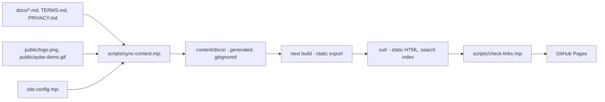

# Documentation website

The Markdown files in `docs/`, plus `TERMS.md` and `PRIVACY.md` at the
repository root, are the single source of truth for Qube's documentation.
They read fine directly on GitHub. The same files are also published as a
searchable static website built with [Fumadocs](https://fumadocs.dev/) and
hosted on GitHub Pages:

**[qwerty-2117.github.io/Qube](https://qwerty-2117.github.io/Qube/)**

The website lives in `docs-site/`, a self-contained Next.js project with its
own `package.json` and lockfile. It shares no code, dependencies or build
steps with the Qube app.

## How it works



1. **`site.config.mjs`** maps each source file to a section and a URL slug.
   There are three sections, shown as sidebar tabs: **User guide**,
   **Developer docs** (including a *Design history* folder) and **Legal**.
   `docs/README.md` becomes the `/docs/` overview page.
2. **`scripts/sync-content.mjs`** copies the mapped files into
   `content/docs/`, turns the first `# Heading` into the page title, adds a
   description, writes the sidebar `meta.json` files and copies the two image
   assets into `public/assets/`. It rewrites links:
   - links to other mapped pages become website URLs (anchors are kept);
   - links to any other file in the repository (for example `../LICENSE` or
     a source file) become GitHub links;
   - a link to a file that does not exist **fails the build**.
3. **`next build`** renders every page with Fumadocs (static export,
   trailing slashes) and generates a static search index at `/api/search`.
   Mermaid code blocks are rendered as diagrams in the browser.
4. **`scripts/check-links.mjs`** scans the exported HTML and fails if any
   internal link, image or `#anchor` does not resolve. External links are
   counted but not fetched.

The landing page (`docs-site/app/(home)/page.jsx`) is the only hand-written
page; its feature descriptions summarize the user guide.

### Files in `docs-site/`

| Path | Purpose |
| --- | --- |
| `site.config.mjs` | Site name, tagline, repository URL, section/page map, assets |
| `scripts/sync-content.mjs`, `scripts/check-links.mjs` | Content sync and link checker |
| `next.config.mjs` | Static export, `trailingSlash`, base path from `DOCS_BASE_PATH` |
| `source.config.mjs` | Fumadocs MDX configuration (Mermaid support) |
| `app/` | Landing page, docs layout and page renderer, 404 page, search index route |
| `components/`, `lib/` | Mermaid renderer, MDX components, static search client, shared layout, base-path helper |
| `public/.nojekyll` | Stops GitHub Pages from running Jekyll on the export |

Generated folders — `node_modules/`, `.next/`, `.source/`, `content/`,
`public/assets/` and `out/` — are gitignored.

## Edit the documentation

Edit the Markdown in `docs/` (or `TERMS.md` / `PRIVACY.md`) as usual and use
relative links such as `./automations.md#the-periodic-check-in-heartbeat`.
Then:

- **Adding a new page:** add an entry to the right section in
  `docs-site/site.config.mjs`, and link to it from `docs/README.md`.
- **Renaming a heading:** its anchor changes; search for links to the old
  anchor. The link checker reports any you miss.
- **Diagrams:** use a fenced code block with the `mermaid` language.
- **Avoid raw HTML** outside code blocks — pages are compiled as MDX. Write
  URLs as plain links or in backticks rather than `<https://…>`.

Every page has an **Edit on GitHub** link that opens the original Markdown
file.

## Build and preview locally

Requires Node.js 22 (the version used in CI).

```bash
cd docs-site
npm ci
npm run dev            # live preview at http://localhost:3020
```

To reproduce the production build, including the GitHub Pages base path:

```bash
cd docs-site
DOCS_BASE_PATH=/Qube npm run build
DOCS_BASE_PATH=/Qube npm run check-links
npm run preview        # serves out/ on port 3020
```

`npm run preview` serves `out/` at the server root, so with a base path the
site is reachable at `http://localhost:3020/Qube/` only if you copy `out/`
into a `Qube/` subfolder first; for a quick look, build without
`DOCS_BASE_PATH`.

## Deployment

`.github/workflows/docs.yml` builds and deploys the site. It is independent
of the app's `build.yml`.

| Trigger | What happens |
| --- | --- |
| Push to `main` touching `docs/**`, `docs-site/**`, `TERMS.md`, `PRIVACY.md`, the two image assets or the workflow | Build, check links, deploy to Pages |
| Pull request touching the docs | Build and check links only (no deploy) |
| Manual run (`workflow_dispatch`) | Build, check links, deploy |

Steps: checkout → set up Node 22 with the npm cache → `configure-pages`
(reports the base path) → resolve the base path → `npm ci` → `npm run build`
→ `npm run check-links` → `upload-pages-artifact` (`docs-site/out`) →
`deploy-pages` in the `github-pages` environment.

The base path comes from `actions/configure-pages`: `/Qube` for the project
site, or empty if a custom domain is configured. Pull-request builds use
`/<repository name>`.

### One-time manual setup

A workflow cannot turn on GitHub Pages by itself. A repository admin must:

1. Open **Settings → Pages** in the GitHub repository.
2. Under **Build and deployment → Source**, choose **GitHub Actions**.
3. Run the **Docs** workflow once (Actions → Docs → Run workflow), or push a
   docs change to `main`.

If the `github-pages` environment has deployment protection rules that
restrict branches, make sure `main` is allowed.
