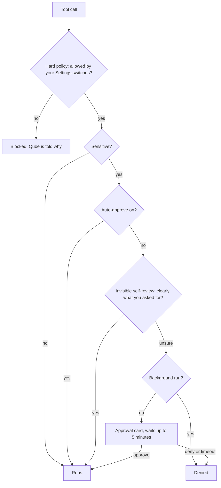

# Permissions and privacy

Qube acts on your behalf, so the ground rules matter. This page documents
exactly when it asks first, where your data lives, and what leaves your
machine. The legal wording lives in the [Terms](../TERMS.md) and
[Privacy Policy](../PRIVACY.md); this is the practical version.

## The approval model

Qube checks every action in up to three layers, in this order:

1. **Hard policy** — the switches in **Settings → Advanced → Heartbeat and
   Task → Configure**:
   - **Tools** (on by default) and **Connectors** (on by default) allow or
     block those whole categories.
   - **Destructive actions** (**off** by default) — while off, deleting files,
     destructive shell commands (`rm -rf`, `sudo`, piped remote install
     scripts, disk formatting and similar), writes to protected system paths,
     deleting items in connected apps, merging pull requests and closing
     issues are **blocked outright**, with no card.
   - **Auto-approve actions** (**off** by default) — when on, sensitive actions
     that pass the policy run without review or card.
2. **Invisible self-review** — for a sensitive action, a separate short call
   to your model compares the exact action with what you asked for. If it
   clearly matches, the action runs without interrupting you; if not, it
   escalates. Each review is logged in `.memory/action-reviews.jsonl`.
3. **Approval card** — the run pauses and a card states the app, the action
   and its target. If you deny, or don't respond within five minutes, the
   action is cancelled and Qube continues with an alternative.

### What counts as sensitive

- **Files outside the workspace**, unless the folder is in your Allowed
  directories list (**Settings → Preferences → Allowed directories**).
- **Sending, posting, creating, updating or deleting** in a connected app —
  emails, Slack messages, GitHub issues, calendar events, Notion pages and
  similar. Creating or editing an email **draft** is not sensitive.
- **Computer-use actions** that click, type, press keys, scroll, drag or
  launch an app outside Qube.
- **Destructive actions** listed above, once you have allowed them.

### Runs without asking

- Reading and writing files **inside its workspace** (deleting files is a
  destructive action — see above).
- Ordinary shell commands in the workspace.
- Read-only web searches and page fetches.
- Read-only connector calls: listing mail, searching tickets, reading pages.
- Read-only computer observations: listing apps, reading a window.
- **Tools from MCP servers you added** — these are not routed through the
  approval layers at all. See [Custom MCP servers](./mcp.md#security-considerations).
- **Actions inside the browser panel** — navigating, clicking, typing and
  submitting forms on websites are not routed through the approval layers.
  Qube is instructed to complete purchases and form submissions you asked
  for, so be specific. See [Browser automation](./browser.md).

### Handled by you in person

Qube detects CAPTCHAs and bot checks and asks you to complete them in the
Browser panel. It requests a takeover for those, and for credentials or
another protected input that only you can supply — a login or two-factor
prompt, for example. You act in the Browser panel, and the task resumes.

### Background runs have stricter rules

There is nobody to show a card to, so a sensitive action that the self-review
does not clearly approve is denied. The periodic check-in can read and
prepare, but its send, post and delete tools are replaced with draft-only
versions. Scheduled tasks can only take the actions their own permission
switches allow, and a send inside a task you explicitly created is treated as
requested by that task's instructions. Computer use is read-only in the
background. See [Automations](./automations.md).

## Where your data is stored

Qube is local-first. There is no Qube cloud account and no Qube server
holding your data.

### Application data directory

Most durable state lives under the per-app data directory, identified by
`com.qube.desktop`:

| OS | Path |
| --- | --- |
| Linux | `~/.local/share/com.qube.desktop` |
| macOS | `~/Library/Application Support/com.qube.desktop` |
| Windows | `%APPDATA%\com.qube.desktop` |

Inside it you will find:

- `.memory/` — settings (`app-settings.json`), AI providers and keys
  (`providers.json`, **stored as plain text** — protect your user account
  and backups accordingly), long-term memory (`memory.json`, plus legacy
  `dual-memory.json` and `semantic-memory.json`), chat sessions and titles,
  scheduled tasks and run logs, MCP server configs, skills, the ChatGPT
  sign-in session (`chatgpt-sessions.json`), the local signing secret
  (`lwc-secret.txt`), the action-review log (`action-reviews.jsonl`) and
  your Composio connection ID (`composio-user-id`).
- `.agents/` — learned/durable skills written outside `.memory/`.
- `.browser-profile/`, `.camoufox*`, `.playwright-mcp/`, `.superpowers/` —
  managed browser profiles, cookies, sessions, and automation state.
- `sidecar.log`, `combined.log`, `error.log`, `install.log`, and
  `startup-error.html` — local diagnostics and generated error pages.
- `agent.sqlite` — only present when the experimental durable storage flag is
  enabled; the default installation uses the JSON files above.

When running from source, the repository root is used instead (override with
the `QUBE_DATA_DIR` environment variable).

### Workspace files

Files Qube creates live in its **workspace** — the `workspace/` folder in a
source checkout, or the sidecar's local working directory in an installed
desktop app (see [Files and the workspace](./files-workspace.md#where-files-live)).
Attachments are saved under `attachments/<chat>/` in the workspace. Treat the
workspace as app-managed storage: use the **Download** button on file cards
to keep important deliverables in your own folders. Workspace content is
separate from the application data directory, which holds your settings,
chats and memory and is preserved across updates and uninstalls. In the
desktop app the workspace itself lives in the temporary sidecar copy, so an
update can rebuild it; keep deliverables you care about with **Download**.

The desktop app also keeps a temporary copy of its local server under the
system temp directory (`qube-sidecar` or a pid-suffixed `qube-sidecar-*`
directory); it is rebuilt automatically and is safe to clear while Qube is
closed. Hard Reset deletes this temporary copy, so the desktop workspace is
erased too.

If you set `WORKSPACE_PATH` to a folder outside the application data
directory, Hard Reset does not delete that external folder. Remove it
yourself if you want a complete wipe.

### Deleting your data

- Delete individual chats from the sidebar; their sessions and snapshots are
  removed.
- There is no memory on/off switch or memory list in the current Settings
  UI. To erase stored memories, use **Settings → Advanced → Hard Reset**, or
  quit Qube and delete the memory files under `.memory/` in the data
  directory.
- **Settings → Advanced → Hard Reset** signs out of ChatGPT, pauses background
  work, and wipes every local state file (`.memory/`, including scheduled
  tasks, heartbeat work, approvals, memories, and the cross-chat announcement
  ledger), learned skills (`.agents/`), the experimental `agent.sqlite`, the
  managed browser profiles, connector keys, provider settings, diagnostics,
  and workspace deliverables including chat attachments. It also clears
  browser storage, the webview's native browsing data, and in-process caches,
  and in the desktop app turns off launch-at-login, then reloads or restarts
  Qube. This cannot be undone.
- Hard Reset does **not** delete anything held by outside services: apps you
  connected through Composio stay connected at Composio until you disconnect
  them in **Settings → Connectors** (do this *before* a reset), and data
  already sent to your AI provider is governed by that provider.
- Uninstalling the app leaves the data directory in place deliberately; use
  Hard Reset first or delete the data directory manually for a complete
  removal. See [Desktop app details](./desktop.md#uninstalling).

## What leaves your device

- **Your AI provider receives every message you send**, plus the conversation
  history, file excerpts, tool outputs, attachments and memory entries needed
  to answer — under that provider's own terms. Choose a local model
  (Ollama/LM Studio) if you want fully offline reasoning.
- **Connected services receive only the actions you request**, routed through
  [Composio](https://composio.dev/), which holds the app connections.
- **Browser and computer observations** (page text, screenshots, app window
  state) are included in model context only when the task needs them.
- **Web search terms** go to DuckDuckGo and Bing; pages Qube reads are
  fetched directly from their sites.
- **Other network requests Qube makes:** checking GitHub for app updates;
  looking up the current Codex client version on the npm registry (ChatGPT
  sign-in); loading site icons for cited sources from DuckDuckGo's icon
  service and app logos from Composio's logo service; browsing the skills
  marketplace when you open it; and your MCP servers, if you added any.
- Qube itself embeds no advertising, analytics, or cross-site tracking. The
  ChatGPT sign-in uses a local session cookie to keep you signed in.

## Practical safety habits

- Review an approval card's description before accepting — it states the app,
  action and target.
- Keep backups of important files; treat generated content as a first draft
  and verify anything high-stakes (medical, legal, financial).
- Prefer Allowed directories over blanket approvals for recurring project
  folders.
- Audit connected apps and MCP servers periodically and disconnect anything
  you no longer use.
